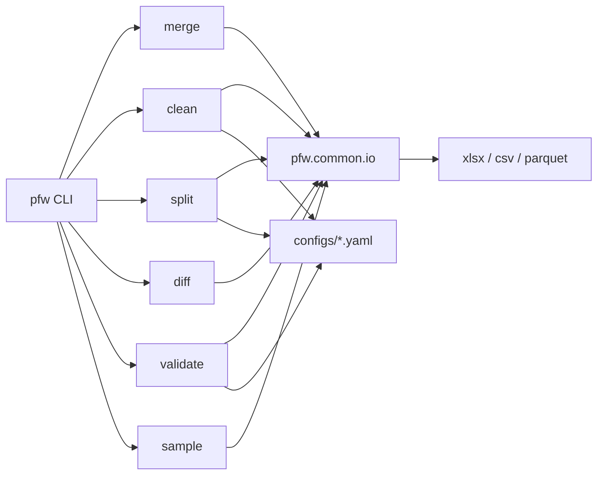

# Python for Work

Everyday Excel utilities for analysts and operations teams — merge, clean, split, diff, and
validate tabular files from one `pfw` command. Built with pandas + openpyxl (CSV and Parquet
too). Requires Python 3.10+.

## Utilities

| Utility | What it does | Sample result (measured) |
|---------|--------------|--------------------------|
| [merge](docs/merge.md) | Merge every workbook in a folder into one file | 3 files → **272** rows |
| [clean](docs/clean.md) | Standardize names, dates, phones; drop dupes/empties | 10 dirty → **8** clean rows |
| [split](docs/split.md) | Split one workbook by a column value | 100 rows → **5** files |
| [diff](docs/diff.md) | Diff two workbook versions cell by cell | **2** added, **2** deleted, **6** changed |
| [validate](docs/validate.md) | Validate rows against YAML rules before import | **5** valid, **7** error rows, **17** findings |

Numbers come from running each demo on the included sample generators, not estimates.

## Architecture



## Quickstart

```bash
pip install -e ".[dev]"
pfw sample merge -o ./sample
pfw merge ./sample ./output/hasil_gabungan.xlsx
```

Other commands follow the same pattern: `pfw sample <utility>`, then `pfw <utility> ...`.
See `pfw --help` and each page under [docs/](docs/).

YAML configs (kept where they add real value) live in `configs/` for **clean**, **validate**,
and optional **split** defaults. **merge** and **diff** are CLI-arg driven.

## Repository layout

```text
src/pfw/           Package: CLI + utilities + common helpers
configs/           YAML for clean / validate / split
docs/              Per-utility guides
tests/             pytest suite
```

## Development

```bash
pip install -e ".[dev]"
ruff check .
pytest -q
```

CI runs the same lint and tests on every push and pull request.

## License

MIT License. See [LICENSE](./LICENSE).
